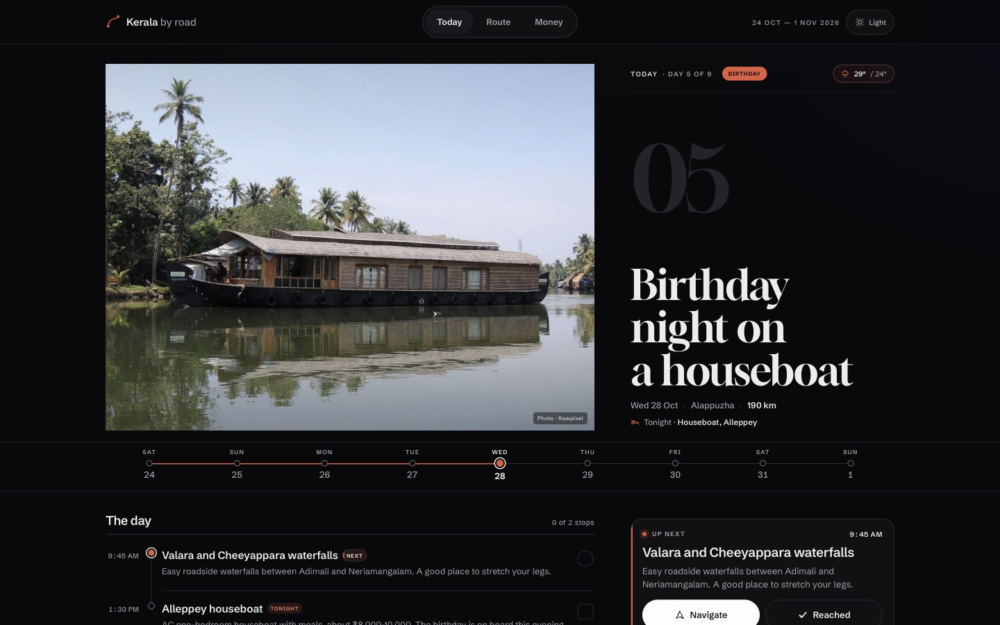

# Kerala by road — 2026




**Live at <https://abdul-alim.github.io/>** — open it in Safari on the iPhone, then
Share → Add to Home Screen.

A nine-day road trip companion for the drive from Potheri to Madurai, up to
Munnar, a birthday night on an Alleppey houseboat, then Kochi and home through
Salem. It is a single-file, installable, offline-capable web app for the phone
on the road and the desktop at home, built for the four of us.

## What is in here

| File | Purpose |
| --- | --- |
| `index.html` | The whole app: data, styles, map and logic. No build step. |
| `fonts/` | Self-hosted Gloock and Schibsted Grotesk, with their SIL OFL licence files. No font request at runtime. |
| `photos/plates/` | The nine day photographs, plus small versions for the route list. |
| `photos/us-1.jpg`, `photos/us-2.jpg` | Our own photographs, used on the Route page. |
| `manifest.webmanifest` | Makes it installable, sets the name, icons, colours and shortcuts. |
| `sw.js` | Service worker. Caches the app, fonts and photographs so it opens with no signal. |
| `icons/` | Home-screen icons, Android maskable icons and the iOS `apple-touch-icon`. |
| `favicon.ico`, `apple-touch-icon*.png` | Browser tab and iOS home-screen icons. |
| `_headers` | Netlify only: content types and caching. GitHub Pages ignores it. |
| `.nojekyll` | GitHub Pages only: serve the files as-is. |

## Using it

The app opens on the day you are on, or day one before the trip starts. Tap the
journey strip, the **Route** tab, or — on a desktop — the top navigation to move
between days. The sun/moon button in the masthead switches appearance at any time.

- **Today** — one day at a time. A photograph, the day's title, the drive and
  where you sleep, then the next thing to do, the four at-a-glance numbers, the
  plan as a route thread, the notes worth knowing, an hour-by-hour timeline, and
  a shortlist of places nearby rated for this family. Each stop opens a sheet
  with a photograph when one is available, directions and the reached/skipped actions.
- **Up next** — the next unmarked stop, with one-tap directions and a **Reached**
  button. Stays use their own verb: *Checked in*, *Boarded*, *Back*.
- **Route** — the whole loop on one map, the nine days as a photographic index,
  and the road notes.
- **Money** — what the trip costs, each night, the bookings, the car, the packing
  and the checks. Ticks save on this phone only.
- **Set location** — on any hotel night, swap in a different hotel, address or
  pin. It is used everywhere for that night, including the directions link, and
  saved on this phone.
- **Good to know** folds — every day has a few notes that save you a phone call,
  and the hour-by-hour timeline marks the current hour on the day itself.

Reached marks, skipped stops, custom locations and checklist ticks are stored on
the device. They are not shared between phones.

Each day shows the forecast from [Open-Meteo](https://open-meteo.com) — free, no
API key, no signup, CORS-enabled. One request covers all nine days; it is cached
for three hours, and the app shows nothing rather than guessing if the call fails.
Directions open Google Maps and need a signal. Everything else works offline,
including the notes, photographs, fonts and map.

Keyboard: the journey strip responds to the left and right arrow keys. Escape
closes any sheet. The app respects reduced-motion settings.

## The stays

| Night | Where |
| --- | --- |
| 24 Oct | Sterling V Grand Madurai |
| 25 Oct | Avadale Munnar, Chinnakanal |
| 26–27 Oct | The Regalia Munnar, Chinnakanal |
| 28 Oct | Alleppey houseboat — birthday dinner on board, night on the boat |
| 29–30 Oct | Ernakulam hotel, near Marine Drive |
| 31 Oct | Salem hotel |
| 1 Nov | Home |

## Design notes

The brief was to make a personal itinerary feel like something worth opening
every morning. The result is a **photographic field guide** in a dark-and-paper
palette: near-black and warm cream, one orange thread, with violet and teal as
its only other notes. It is deliberately not a dashboard.

- **Photographs, not decoration.** Each day opens with a real place, cropped to
  four-by-three and colour-graded consistently. The last day is the four of us.
  The family photographs on the Route page are ours.
- **Type.** Gloock sets the day and page titles and nothing else; Schibsted
  Grotesk carries every label, number and paragraph. Both are self-hosted, so the
  first paint does not wait for Google Fonts and the app works with no signal.
- **The thread.** The journey strip, the day's plan rail, the progress line and
  the map are one continuous route. The primary orange is the path already
  travelled; each day keeps a small accent of its own — orange, violet or teal.
  It is the only structural flourish.
- **Surfaces.** A paper field in light, a near-black field in dark; thin borders,
  restrained surface cards for the next action, the facts and tonight, and
  generous margins. The desktop prep opens as a full-width booking list, then three side-by-side lists. White space is
  still the hierarchy.
- **Light and dark.** The supplied palette runs in both directions: cream, sand
  and ink in light; void, surface and cool grey in dark; primary orange,
  secondary violet and teal throughout. Photographs stay untouched. The sun/moon
  switch starts from the phone's appearance, remembers an explicit choice on this
  device, and updates the browser's theme colour with it, without a flash.
- **A real desktop.** From 1000px up the phone dock gives way to a sticky top bar
  with a pill navigation, and the day opens with its number set large beside the
  photograph. Today is a plan with a sticky action rail of cards; Route pairs the
  map with the nine-day index, then the family photographs with the road notes;
  Money sets the budget beside a full-height nights card and opens the prep as a
  full-width booking list plus three grouped columns. The phone layout is unchanged.
- **Motion.** Day and tab changes fade and lift; the plan bar draws; the map line
  draws once; the sheet springs up and can be dragged down; a toast confirms a
  mark and offers Undo. Nothing moves without a reason, and everything stops for
  `prefers-reduced-motion`.
- **Touch.** The journey strip shows all nine days at once on a phone. The main
  controls are 44px tall; the icon-only close on a sheet is 40px, and the sheet
  also closes from the scrim, a drag or Escape.

## Photograph credits

The nine day photographs are cropped and colour-graded for the app. The full
credits and licence links are in the app under **Photographs & credits** on the
Route or Money page.

| Day | Photograph | Photographer | Licence | Source |
| --- | --- | --- | --- | --- |
| 1 | Meenakshi Amman West Tower | KennyOMG | CC BY-SA 4.0 | [Wikimedia Commons](https://commons.wikimedia.org/wiki/File:Meenakshi_Amman_West_Tower.jpg) |
| 2 | Munnar valley | Abhiram RG | CC0 1.0 | [WordPress Photos](https://wordpress.org/photos/photo/70965c342a/) |
| 3 | Tea plantation at Munnar | Gautam Garg | CC0 1.0 | [WordPress Photos](https://wordpress.org/photos/photo/13765c47f6/) |
| 4 | Nilgiri tahr at Eravikulam | Aveek Bandyopadhyay | CC BY-SA 4.0 | [Wikimedia Commons](https://commons.wikimedia.org/wiki/File:Nilgiri_Tahr_at_Eravikulam_National_Park.jpg) |
| 5 | Houseboat on the backwaters | Unknown (Rawpixel) | CC0 1.0 | [Rawpixel](https://www.rawpixel.com/image/6040834/boat-house-free-public-domain-cc0-photo) |
| 6 | Chinese fishing nets at sunset | Jose Varghese | CC0 1.0 | [WordPress Photos](https://wordpress.org/photos/photo/7863ef00c0/) |
| 7 | Marine Drive, Kochi at dusk | Dhruvaraj S | CC BY 2.0 | [Wikimedia Commons](https://commons.wikimedia.org/wiki/File:Marine_Drive_Kochi_Ernakulam_Kerala.jpg) |
| 8 | The highway through Tamil Nadu | TamilWiki Media Contest | CC BY-SA 3.0 | [Wikimedia Commons](https://commons.wikimedia.org/wiki/File:Looking-down-National-Highway-Chittode-Junction.JPG) |
| 9 | The four of us | — | Personal | — |

Where an image is CC BY-SA, the cropped and graded version in this app is shared
under the same licence. Weather forecast by Open-Meteo. The map is drawn for
this trip.

The fonts are used under the SIL Open Font License 1.1; the licence texts are in
`fonts/OFL-Gloock.txt` and `fonts/OFL-SchibstedGrotesk.txt`.

## Updating the app

Edit `index.html` (and, if the photographs change, the files in
`photos/plates/`), then **bump the cache name in `sw.js`**:

```js
const CACHE = "kerala-v30";      // -> "kerala-v31"
const RUNTIME = "kerala-rt-v30"; // -> "kerala-rt-v31"
```

Then re-upload or push. Page loads prefer the network, so edits show up on the
next open; bumping the cache clears the old assets out of storage.

If you replace a photograph, keep its filename or update both the `PHOTOS` array
in `index.html` and the `CORE` list in `sw.js`.

## Testing on the computer

A service worker will not run from a `file://` path, so serve the folder:

```bash
cd kerala-trip-app
python3 -m http.server 8899
```

Then open <http://127.0.0.1:8899>.

To preview a specific day or a state other than the real date:

```
http://127.0.0.1:8899/?now=2026-10-28T14:00   # day 5, mid-afternoon
http://127.0.0.1:8899/?now=2026-10-23T09:00   # before the trip starts
http://127.0.0.1:8899/?day=8                  # open day 8 directly
http://127.0.0.1:8899/?tab=route              # open the Route page
```

`?now` and `?day` are preserved while you move around the app, so a reload
keeps the state you were previewing.

## Putting it online

The app must be served over **HTTPS** for offline caching and "Add to Home
Screen" to work. Upload the **contents** of this folder, not the folder itself,
so `index.html` sits at the top level. Every path in the app is relative, so it
works from a subfolder or from a domain root.

### Netlify Drop — no account needed

1. Go to <https://app.netlify.com/drop>.
2. Drag this folder onto the page.
3. Open the HTTPS link it gives you on the phone. Claim the site to keep it.

### GitHub Pages

1. Create a new **public** repository, for example `kerala-trip-2026`.
2. Upload the contents of this folder to the repository root.
3. **Settings → Pages → Source: Deploy from a branch**, then **`main`** and
   **`/ (root)`**, and save.
4. After about a minute the app is at
   `https://<your-username>.github.io/kerala-trip-2026/`.

## Installing it on the iPhone

**Use Safari.** Chrome and other browsers on iOS cannot install a web app to the
home screen.

1. Open the hosted link in Safari.
2. Tap the **Share** button.
3. Scroll down and tap **Add to Home Screen**, then **Add**.
4. Open it from the home screen. It runs full screen, with no browser bars.

The app shows this once by itself the first time it is opened in Safari on an
iPhone. It also works offline after the first visit.

## Notes

- All timings, fares and opening hours are planning estimates. Confirm them when
  you book.
- iOS may clear storage for a site that has not been opened for several weeks.
  During the trip it is used daily, so the ticks will hold.
- The forecast and the Wikipedia picture inside a stop sheet need a connection.
  The nine day photographs, fonts and the rest of the app are bundled.
- Ticks and custom locations are per-device and are not shared between phones.
